<table width="100%"><tr>
<td align="left"></td>
<td align="right"></td>
</tr></table>

# Ria Financial Intelligence Agent

`SNOWFLAKE_INTELLIGENCE.AGENTS.RIA_FINANCIAL_AGENT` | display name **Ria Financial Assistant** | Account `AWS161` | Database `RIA_FINANCIAL_INTELLIGENCE` | Warehouse `RIA_FINANCIAL_WH`

A Snowflake Intelligence agent for **cross-border money transfer fraud and the compliance work around it**: senders and beneficiaries, transfers by corridor, channel and payout method, the agent and branch network, digital sessions and devices, card and bank funding sources, fraud alerts and cases, chargebacks, refunds and ACH returns, AML and sanctions screening, SAR and CTR filings, KYC and customer due diligence, and a Customer 360 (lifetime value, transfer frequency, complaints, NPS, recency).

**All data is synthetic. Every fraud score, risk tier and probability comes from a model prediction trained on synthetic data, and the agent says so whenever it quotes one.**

Build time, Snowflake credits and AI tokens: see the [build report](docs/BUILD_REPORT.md).



## What was built

| Layer | Count | Notes |
|---|---|---|
| RAW tables | 27 | 2,699,095 rows. 1,219,785 transfers (2025-06-01 to 2026-11-22), 40,000 customers, 916,542 app sessions |
| ANALYTICS views | 26 | Masked agent-safe views, `CUSTOMER_360`, `FRAUD_360`, 11 ML feature views |
| Semantic views | 10 | `RIA_*_SV` for Cortex Analyst |
| Cortex Search services | 6 | `RIA_*_SEARCH` over typologies, case notes, SAR narratives, policies, complaints and NPS comments |
| ML models | 10 | Registered in `RIA_FINANCIAL_INTELLIGENCE.ML`, scored into 10 `ANALYTICS.*_SCORES` tables, inventoried in `ML.MODEL_REGISTRY` |
| Agent functions | 13 | 10 model tools plus overview, model registry and customer brief |
| Agent tools | 30 | 10 Analyst + 6 Search + 13 functions + chart |

Confirmed fraud is 0.69% of transfers (8,390 of 1,219,785); send volume is $576.8M.



## The 10 fraud models

| # | Model | Algorithm | Target | ROC AUC | PR AUC | Positives | Agent tool |
|---|---|---|---|---|---|---|---|
| 1 | Transaction fraud score | XGBoost | IS_FRAUD per transfer | 0.961 | 0.758 | 0.69% | `GetTransactionFraudScore` |
| 2 | Account takeover (ATO) | XGBoost | ATO event per login session | 0.996 | 0.796 | 0.18% | `GetAccountTakeoverRisk` |
| 3 | Synthetic identity detection | XGBoost | Synthetic-ID flag per new customer | 0.993 | 0.816 | 1.46% | `GetSyntheticIdentityRisk` |
| 4 | Money mule / beneficiary risk | XGBoost | Mule flag per beneficiary | 0.997 | 0.751 | 1.14% | `GetMuleBeneficiaries` |
| 5 | Structuring / AML pattern | XGBoost | Structuring flag per customer-week | 0.990 | 0.889 | 9.57% | `GetStructuringAlerts` |
| 6 | Agent/branch collusion | XGBoost | Collusion flag per agent location | 0.980 | 0.833 | 5.25% | `GetAgentCollusionRisk` |
| 7 | Card-funded / CNP fraud and chargeback | XGBoost | Chargeback within 90 days per card-funded transfer | 0.774 | 0.160 | 0.53% | `GetChargebackRisk` |
| 8 | Scam victim (APP / elder fraud) | XGBoost | Confirmed scam-victim flag per transfer | 0.986 | 0.308 | 0.08% | `GetScamVictimAlerts` |
| 9 | Fraud ring / network anomaly | Isolation forest (sklearn Pipeline) | Anomaly score per customer and phone cluster | 0.979 | 0.196 | 0.69% | `GetFraudRings` |
| 10 | Sanctions screening false-positive triage | XGBoost | True match vs false positive per screening hit | 0.908 | 0.520 | 4.36% | `GetScreeningTriage` |

Model metrics come from synthetic data in which the generator creates both the features and the labels. They are not production performance. 5 models (#2, #3, #4, #5, #8) score above 0.985 ROC AUC. Each was checked for label leakage: no input column is derived from the label, and the best single feature on its own is far below the model score, so the high values reflect several independent synthetic signals stacking, not a leak. The notebook prints that evidence and `ML.MODEL_REGISTRY.METRIC_NOTE` records it. Several rounds of generator changes added label noise, decoys and overlap to bring the metrics down.



## Standards reflected in the build

| Standard | Where it shows up |
|---|---|
| BSA/AML (FinCEN) | `SAR_FILINGS` (`DUE_DATE` = detection + 30 days, `DAYS_TO_FILE`), `CTR_FILINGS` (cash over $10,000 in a day), `STRUCTURING_REVIEWS`, structuring model, `COMPLIANCE_FILINGS` view |
| OFAC and global sanctions | `SANCTIONS_SCREENING`: match score, list source (SDN, EU, UN, UK HMT), disposition (Pending, Cleared, Escalated, Blocked), triage model |
| FATF Travel Rule | `TRANSFERS.TRAVEL_RULE_REQUIRED` at $3,000 or more with originator and beneficiary fields. 7,247 transfers require it, 0 are missing data |
| KYC / CDD / EDD | `KYC_PROFILES`: risk rating, PEP, EDD required and completed, ID verification, review dates |
| PCI DSS | `FUNDING_SOURCES` stores token, BIN and last 4 only. No full card numbers anywhere |
| GLBA / privacy | Analytical views mask names to initials, email to domain, phone to last 4, and expose age bands, never SSNs or full account numbers. 0 unmasked identity columns in non-feature ANALYTICS views |
| Reg E / CFPB remittance rule | `CANCELLED_WITHIN_WINDOW`, `REFUNDS.WITHIN_REG_E_TIMELINE`, `DISPUTES.WITHIN_90_DAYS`, `DISPUTE_ACTIVITY` view |
| NACHA | `ACH_RETURNS.RETURN_CODE` (R01, R02, R03, R04, R05, R07, R08, R09, R10, R16) on bank-funded transfers |
| SR 11-7 / OCC 2011-12 | `ML.MODEL_REGISTRY`: owner, version, training date, metrics, validation status, intended use for all 10 models |
| FFIEC | `CASE_EVENTS`: alert to case to disposition audit trail with analyst and timestamps |

## Quick start

```bash
# 1. Review the SQL, then build everything (steps 1-9)
python3 scripts/deploy.py --connection AWS161

# 2. Test the agent against all 16 sample questions
python3 scripts/test_agent.py --connection AWS161

# 3. Regenerate diagrams or the notebook if you edit them
python3 scripts/build_svgs.py --connection AWS161
python3 scripts/check_svg.py docs/images/*.svg
python3 scripts/build_notebook.py
```

Step 7 (`notebooks/07_ml_models.py`) trains and registers 10 models and takes 10 to 20 minutes. Rerunning step 3 changes every ID, so `deploy.py` reruns step 7 afterwards.

## Project layout

```
sql/setup/01_database_and_schema.sql      database, schemas, warehouse
sql/setup/02_create_tables.sql            27 RAW tables
sql/data/03_generate_synthetic_data.sql   synthetic data (one session)
sql/views/04_create_views.sql             views, ML feature views, score tables
sql/views/05_create_semantic_views.sql    10 Cortex Analyst semantic views
sql/search/06_create_cortex_search.sql    6 Cortex Search services
notebooks/07_ml_models.py (.ipynb)        10 models, registry, scores, MODEL_REGISTRY
sql/ml/08_ml_wrapper_functions.sql        13 agent functions
sql/agent/09_create_agent.sql             the agent (generated by scripts/build_agent_sql.py)
scripts/                                  deploy, test_agent, check_svg, build_svgs, build_notebook
agent.md                                  agent description and routing
docs/                                     AGENT_SETUP, questions, ARTIFACTS_GUIDE, DEPLOYMENT_SUMMARY, RAW_COLUMNS, images/
```

## Caveats

- Model metrics come from synthetic data in which the generator creates both the features and the labels. They are not production performance. 5 models (#2, #3, #4, #5, #8) score above 0.985 ROC AUC. Each was checked for label leakage: no input column is derived from the label, and the best single feature on its own is far below the model score, so the high values reflect several independent synthetic signals stacking, not a leak. The notebook prints that evidence and `ML.MODEL_REGISTRY.METRIC_NOTE` records it. Several rounds of generator changes added label noise, decoys and overlap to bring the metrics down.
- Tier definitions: **High** is the lowest out-of-fold score at which precision is at least 50%, **Medium** at least 20%. The fraud ring model is unsupervised, so its tiers are percentile cutoffs.
- Customer recency (Active, At Risk, Lapsed) in Customer 360 is a rule on days since the last transfer. It is not a churn model.
- Validation dates in `ML.MODEL_REGISTRY` are illustrative governance values for the demonstration.
- The agent runs tools with the caller's role. Grant database access to other roles before sharing the agent beyond `ACCOUNTADMIN`.
