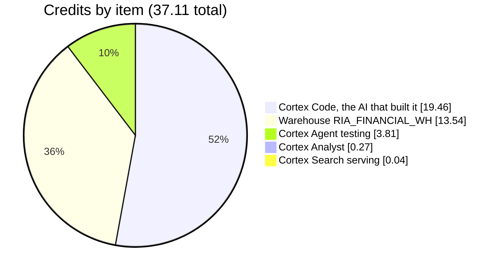
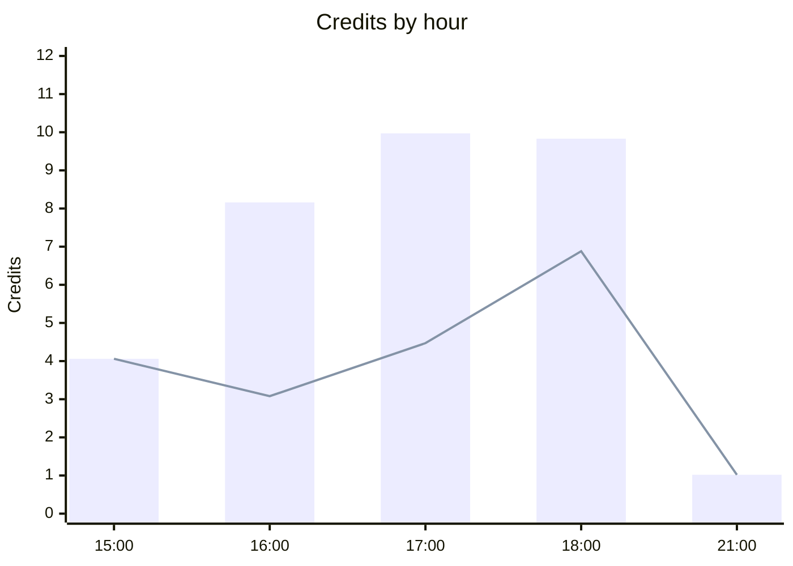

  

# Build report

**A complete fraud and compliance agent for Ria Financial, from first prompt to GitHub, in one afternoon for 37 credits.**

Back to the [README](../README.md).

## At a glance

| 3 h 30 min | 37.11 credits | 10 ML models | 16 / 16 |
|:---:|:---:|:---:|:---:|
| active build time | total, platform plus AI | trained, registered, scored | agent test questions passed |

| 27 tables | 2.7M rows | 30 agent tools | 5 diagrams |
|:---:|:---:|:---:|:---:|
| synthetic RAW data | across the data model | models, search, analyst | architecture to deployment |

## What got built

In about three and a half hours of active work, the project went from an empty account to a working Snowflake Intelligence agent:

- **Data foundation:** a database with 27 tables and 2.7M rows of realistic synthetic transfers, senders, agents, alerts, cases and filings. The generator was rebuilt several times until the models stopped scoring suspiciously close to perfect.
- **Semantic layer:** 10 semantic views for Cortex Analyst and 6 Cortex Search services.
- **Machine learning:** 10 models trained, registered in the Model Registry and scored, exposed through 13 functions.
- **The agent:** `RIA_FINANCIAL_AGENT` with 30 tools, passing all 16 test questions.
- **Documentation:** 5 SVG diagrams, the README, setup and deployment guides, and a build log.

## How the afternoon went

```mermaid
gantt
    title Build timeline, 2026-11-23 (Mountain time)
    dateFormat HH:mm
    axisFormat %H:%M
    section Build
    Setup and design        :done, a1, 15:05, 16:00
    Data realism            :done, a2, 16:00, 17:40
    Models and agent        :done, a3, 17:40, 18:00
    Test, diagrams, docs    :done, a4, 18:00, 18:40
    section Wrap-up
    Follow-up               :done, a5, 21:15, 21:27
```

| Phase | When | What happened |
|---|---|---|
| Setup and design | 15:05 to 16:00 | Read `agent (1).md` and the Rocket Lab template, then built the database, 27 tables and the first data generator |
| Data realism | 16:00 to 17:40 | Generator rebuilt several times to remove near-perfect model scores. Views, 10 semantic views, 6 search services |
| Models and agent | 17:40 to 18:00 | 10 models trained and registered, 13 functions, agent created |
| Test, diagrams, docs | 18:00 to 18:40 | Final data rebuild with automatic rescoring (about 10 min for step 7), 16/16 agent test, 5 SVGs, README and docs, build log |
| Follow-up | 21:15 to 21:27 | Build log corrections, GitHub repo, repo rename, this report |

On the clock it ran about 6 h 20 min, from 15:05 to 21:27, but there was no AI use between 18:40 and 21:00. Phase boundaries come from file timestamps and usage records, so they are approximate.

## Where the 37.11 credits went

Roughly half went to the AI doing the building, and half to Snowflake running the data, models and agent.

Bars show warehouse plus Cortex Code credits per hour; the line shows Cortex Code alone. Hourly figures for the agent, Analyst and Search are not broken out, so they are not in this chart. The 16:00 and 17:00 peaks are the repeated data generation runs.

### Snowflake platform: 17.65 credits

| Item | Credits | Notes |
|---|---:|---|
| Warehouse `RIA_FINANCIAL_WH` | 13.54 | 13.29 compute + 0.25 cloud services. By hour: 16:00 5.08, 17:00 5.50, 18:00 2.95. Mostly data generation (about 2 min per run, run many times), feature views and model scoring |
| Cortex Agent `RIA_FINANCIAL_AGENT` | 3.81 | 33 requests: the 16-question test run twice plus probes |
| Cortex Analyst | 0.27 | Semantic view checks and agent tool calls |
| Cortex Search serving | 0.04 | 6 services |
| **Total** | **17.65** | |

### Cortex Code: 19.46 credits

| Model | Requests | Output tokens | Cache read | Cache write | Fresh input |
|---|---:|---:|---:|---:|---:|
| claude-sonnet-5-5 | 157 | 599,328 | 76,759,239 | 6,364,182 | 338 |
| claude-opus-5-5 | 72 | 100,554 | 8,607,356 | 428,825 | 172 |
| claude-haiku-5-5 | 2 | 24 | 0 | 0 | 764 |
| **Total** | **230** | **699,906** | **85,366,595** | **6,793,007** | **1,274** |

Cortex Code credits by hour: 15:00 4.06, 16:00 3.08, 17:00 4.47, 18:00 6.88, 21:00 1.02.

## The token story

Snowflake reports **92,252,792 tokens** across 230 Cortex Code requests, which sounds enormous. Most of it is the conversation being re-read from cache on every request: 93% of the tokens are cached reads, which are billed at a fraction of fresh input. The model actually wrote about **0.7 million tokens** of new code, SQL and documentation.

Agent testing used a further 5,684,230 tokens across 33 agent requests.

## Cost per deliverable (rough)

| Deliverable | Credits each |
|---|---:|
| Per RAW table | 1.37 (37.11 / 27) |
| Per ML model | 3.7 (37.11 / 10) |
| Per agent tool | 1.2 (37.11 / 30) |

## What is not counted

- Usage views lag by up to a few hours, so anything after about 21:25 may not be included.
- The Cortex Code figure covers every Desktop request by `SNOWMAN` from 15:00 onward. I assumed all of it belongs to this project.
- Search service indexing, the Model Registry, and storage for the 2.7M rows are not separate lines in these views, and are small or folded into the warehouse figure.
- A small serverless task charge (0.06 credits) in the same window was left out because it cannot be tied to this project.
- Time spent by you reviewing outside the chat is not measured.

## Source

`SNOWFLAKE.ACCOUNT_USAGE` (`WAREHOUSE_METERING_HISTORY`, `METERING_HISTORY`, `CORTEX_AGENT_USAGE_HISTORY`, `CORTEX_ANALYST_USAGE_HISTORY`, `CORTEX_SEARCH_DAILY_USAGE_HISTORY`, `CORTEX_CODE_DESKTOP_USAGE_HISTORY`) for account `AWS161`, user `SNOWMAN`, on 2026-11-23 (Mountain time).
